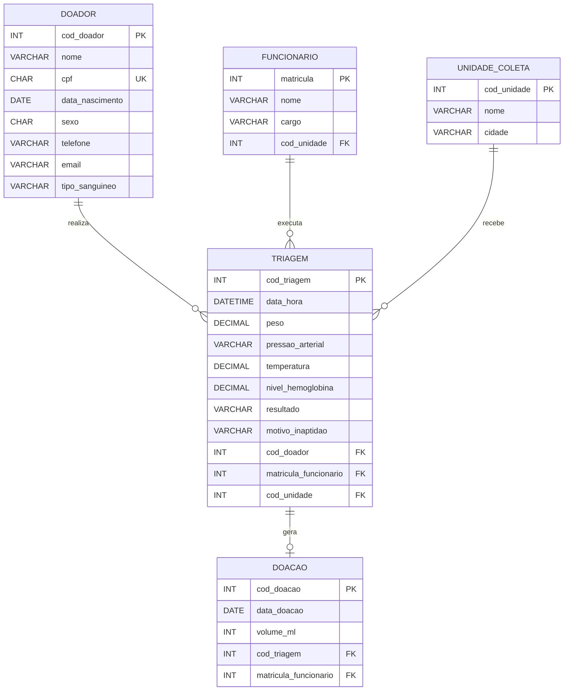

# Diagrama entidade-relacionamento: doador e triagem

## Leitura das cardinalidades

- Um doador pode realizar nenhuma ou varias triagens; cada triagem pertence a exatamente um doador.
- Um funcionario pode executar nenhuma ou varias triagens; cada triagem possui um funcionario responsavel.
- Uma unidade de coleta pode receber nenhuma ou varias triagens; cada triagem ocorre em uma unidade.
- Uma triagem apta pode gerar nenhuma ou uma doacao; cada doacao possui uma triagem de origem.
